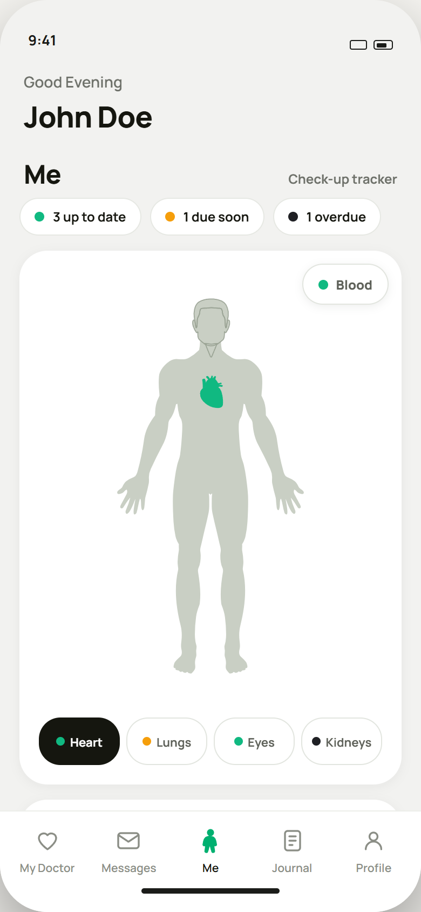
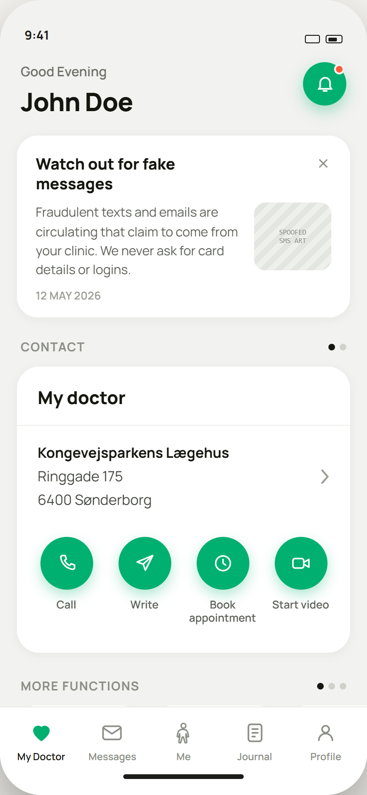
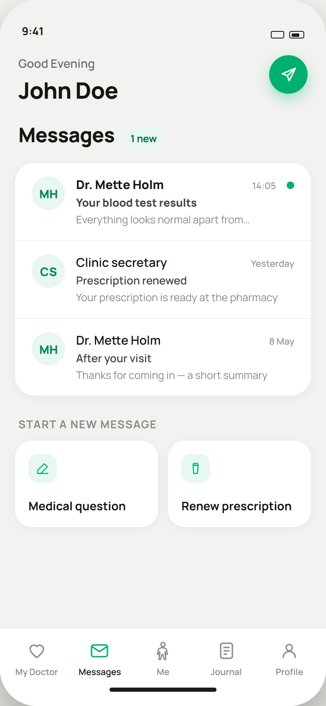
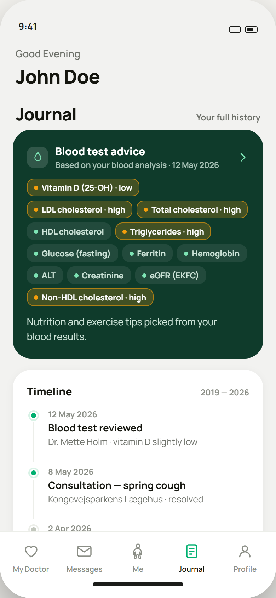
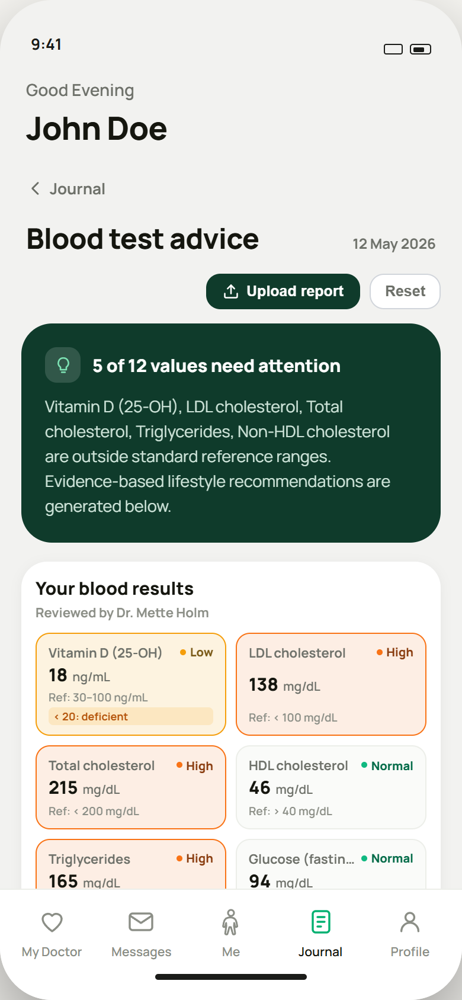
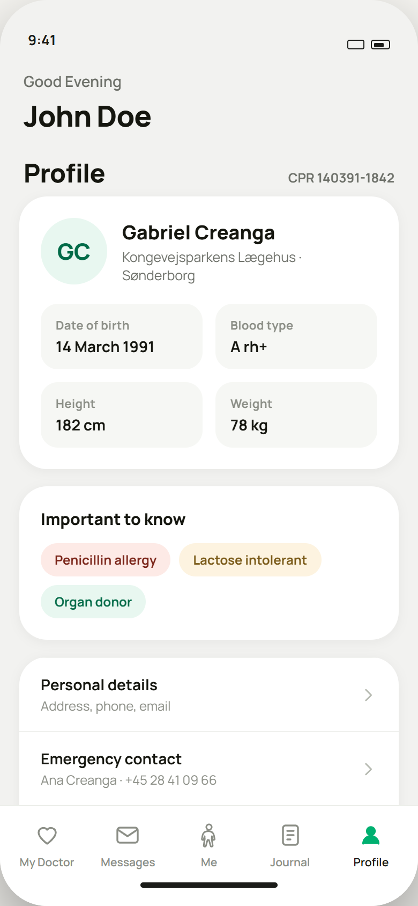
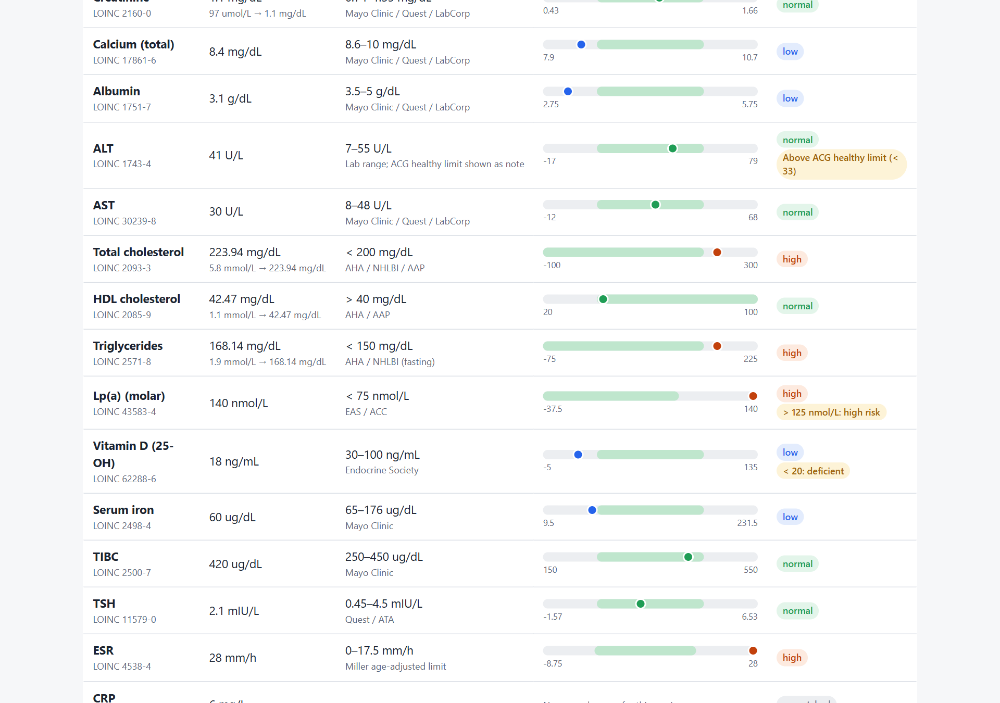

<div align="center">


# 🩺 Medical Cabinet

**A mobile health-record prototype that keeps your whole medical life in one pocket-sized place:
check-ups, messages with your clinic, your health journal, and plain-language advice from your blood tests.**


</div>

---

## ✨ What it does

Medical Cabinet imagines what a patient-facing health app could look like if it were
**calm, clear and actually useful**. It is built mobile-first and installs to a phone home screen as a PWA.

| | Feature | What you get |
|---|---|---|
| 🧍 | **Me: body map and check-up tracker** | Tap an organ (heart, lungs, eyes, kidneys, blood) to see when it was last checked and what's due soon or overdue |
| 👩‍⚕️ | **My Doctor** | Your clinic at a glance, with one-tap *Call / Write / Book appointment / Start video*, plus a warning banner about fake messages |
| ✉️ | **Messages** | Inbox with your doctor and the clinic secretary, a compose sheet, and quick "renew prescription" requests |
| 📓 | **Journal** | A full health timeline (consultations, scans, vaccines, lab results) grouped into records |
| 🩸 | **Blood test advice** | Upload a lab report (CSV): every marker is compared against reference ranges, and you get nutrition and exercise tips for the values that need attention |
| 👤 | **Profile** | Personal facts, allergies and flags, emergency contact, saved per user with Supabase |

## 📱 Screenshots

<table>
  <tr>
    <td align="center"><br/><b>Body map and check-ups</b></td>
    <td align="center"><br/><b>My Doctor</b></td>
    <td align="center"><br/><b>Messages</b></td>
  </tr>
  <tr>
    <td align="center"><br/><b>Journal and timeline</b></td>
    <td align="center"><br/><b>Blood test advice</b></td>
    <td align="center"><br/><b>Profile</b></td>
  </tr>
</table>

### 🔬 Blood report comparison tool

A standalone prototype in [`tools/blood-compare/`](tools/blood-compare/README.md). It converts units, picks the right
reference range for your age, sex, pregnancy and lab analyzer, and plots each value against its range.



> [!NOTE]
> This is a demo and educational prototype, **not a medical device**. Use fictional data only.

---

## 🗂️ Layout

```
app/        React app (this is the one you work in)
index.html  the original single-file prototype (bundled export, kept for reference)
serve.py    static server for that original file
tools/blood-compare/  standalone blood-report comparison prototype (separate from the app)
supabase/   database migrations (profiles table with row level security)
docs/       README images
```

The React app in `app/` is a port of the original. Same screens, same styling,
ordinary source you can edit. See [app/README.md](app/README.md) for the file
map and notes on what changed in the port.

The code is split into 5 epics, one per tab, so several people can work in
parallel: see [EPICS.md](EPICS.md).

## 🚀 Run

```bash
cd app
npm install
npm run dev
```

Opens on `http://localhost:5173`. The dev server also prints a Network URL. Open
that on a phone on the same Wi-Fi to use the app on a real device.

| Script | What |
|---|---|
| `npm run dev` | dev server, hot reload, exposed on the LAN |
| `npm run check` | assertions over the check-up scheduling rules |
| `npm run lint` | oxlint |
| `npm run build` | static bundle into `app/dist/` |
| `npm run preview` | serve that build locally |

## 🔐 Accounts and data (Supabase, optional)

Without configuration the app runs as before, with no sign-in. To turn on
accounts:

1. Create a free project at [supabase.com](https://supabase.com) (EU region).
2. In the dashboard, open **SQL Editor** and run every file in
   `supabase/migrations/` in order. This creates the `profiles` table with
   row level security (each user sees only their own row).
3. For testing: **Authentication > Sign In / Providers > Email**, turn off
   "Confirm email", so new accounts can sign in straight away.
4. Copy `app/.env.example` to `app/.env` and fill in the Project URL and the
   publishable key from **Project Settings > API Keys**. Never use the secret
   key here, and never commit `.env`.
5. Restart `npm run dev`. The app now opens on a sign-in screen, and the
   Profile contact details are saved per user in Supabase.

Demo app: use fictional data only.

## 🌍 Deploying

`npm run build` produces plain static files. Any static host works: Netlify,
Vercel, GitHub Pages. The web manifest ships with it, so the app installs to a
phone home screen from the deployed URL.
